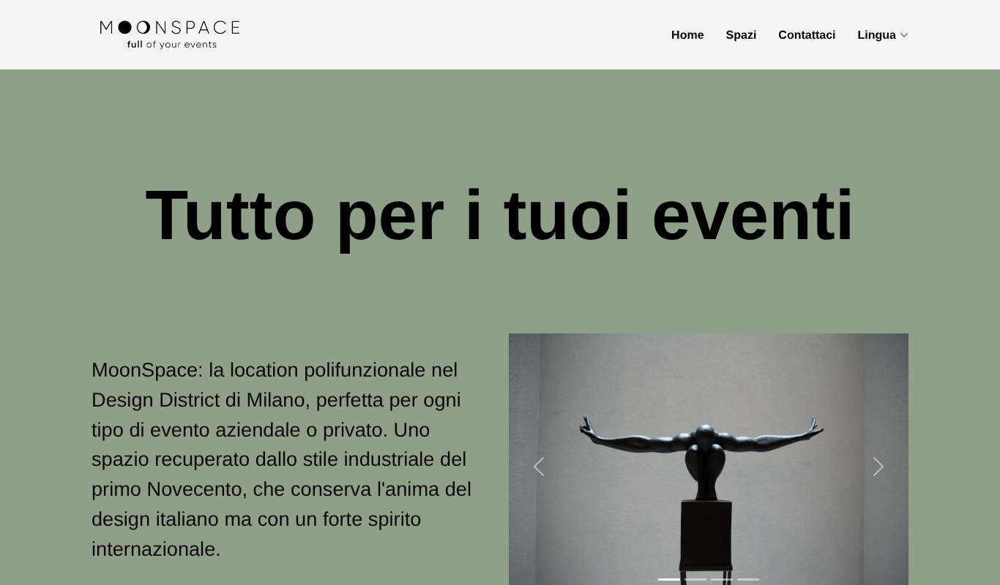

# MoonSpace — Event Venue Website

Website for **MoonSpace**, a multi-purpose event venue in Milan's Design District. Built in 2023 as a real client project.

**Live demo:** https://philipnick.github.io/moonspace-website/



## Features

- Responsive layout for desktop and mobile (collapsible navigation menu)
- Image carousel showcasing the venue spaces
- Contact section with address, phone, opening hours and contact form
- Italian / English language menu
- Privacy policy page and terms acceptance on the contact form

## Tech stack

- **Front-end:** HTML, CSS, JavaScript, Bootstrap
- **Back-end:** Node.js with Express (serves the static site)
- **Deployment:** Google App Engine (`app.yaml`), plus GitHub Pages for the demo

The layout started from the free [FlexStart](https://bootstrapmade.com/flexstart-bootstrap-startup-template/) Bootstrap template and was customised for the client: structure, content, styling and branding.

## Run locally

```bash
npm install
npm start
```

Then open http://localhost:8080.

## Project structure

```
index.js        Express server
app.yaml        Google App Engine configuration
public/         Static site (HTML, CSS, JS, images)
docs/           Screenshots
```

## Notes

- The contact form uses the template's PHP handler, which is not active in the static demo.
- Developed by Filippo Nicotra, with contributions from TommyB05. Full history in the [original repository](https://github.com/Philipnick/moonspace-nicotra).
